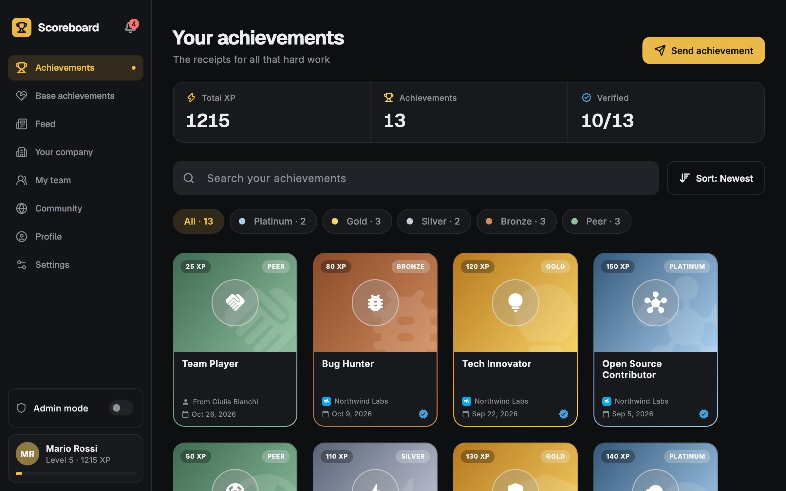
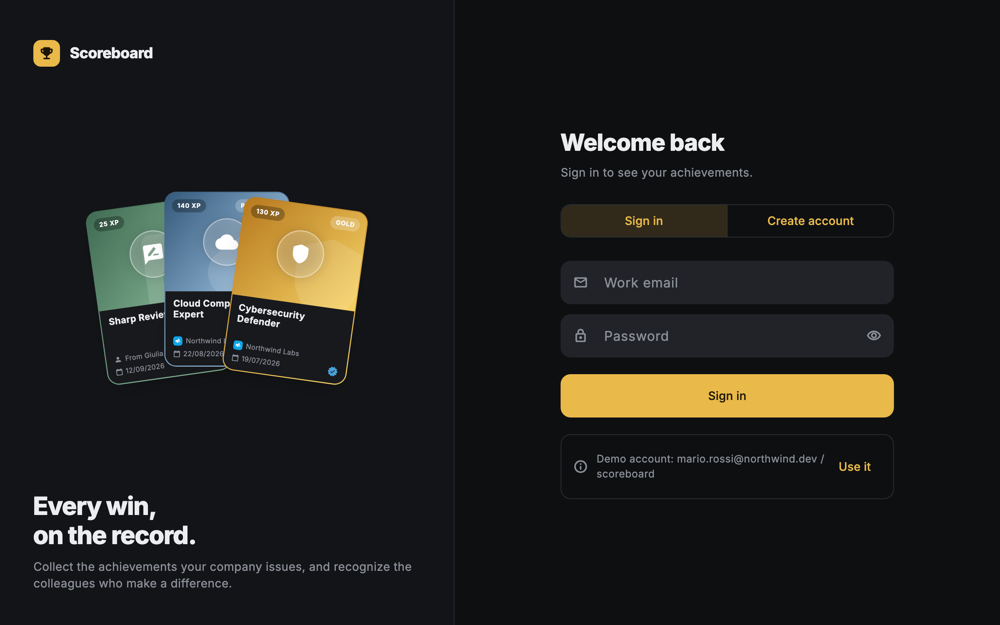
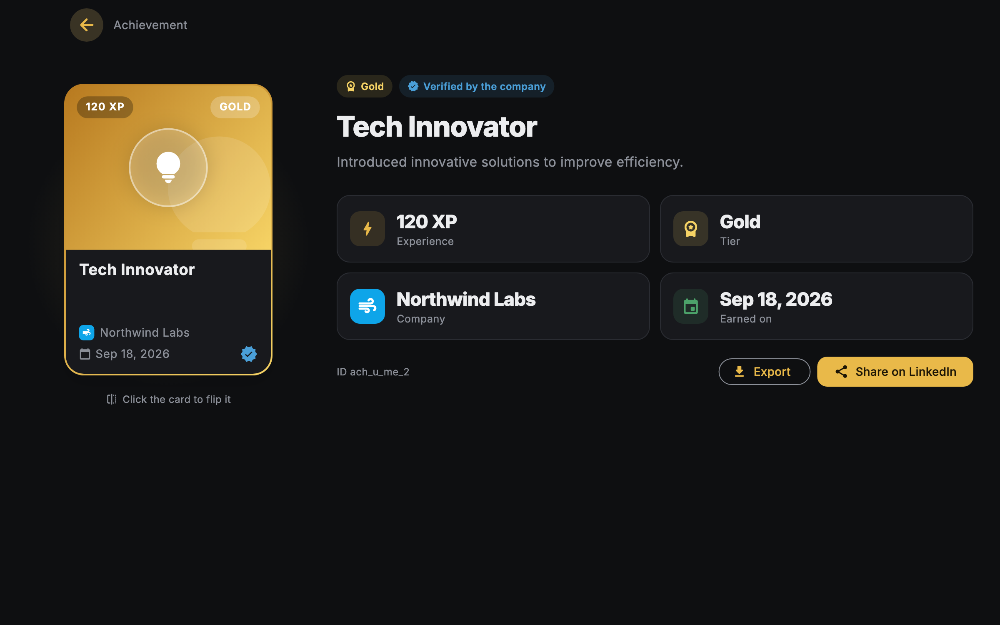
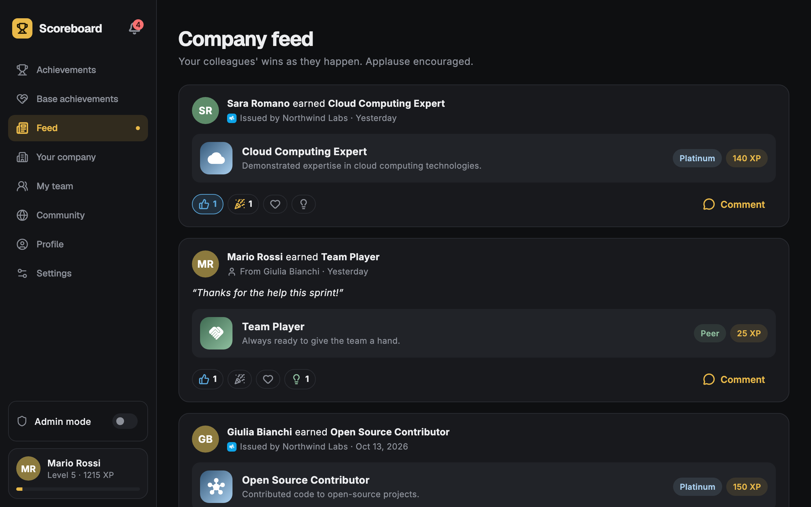
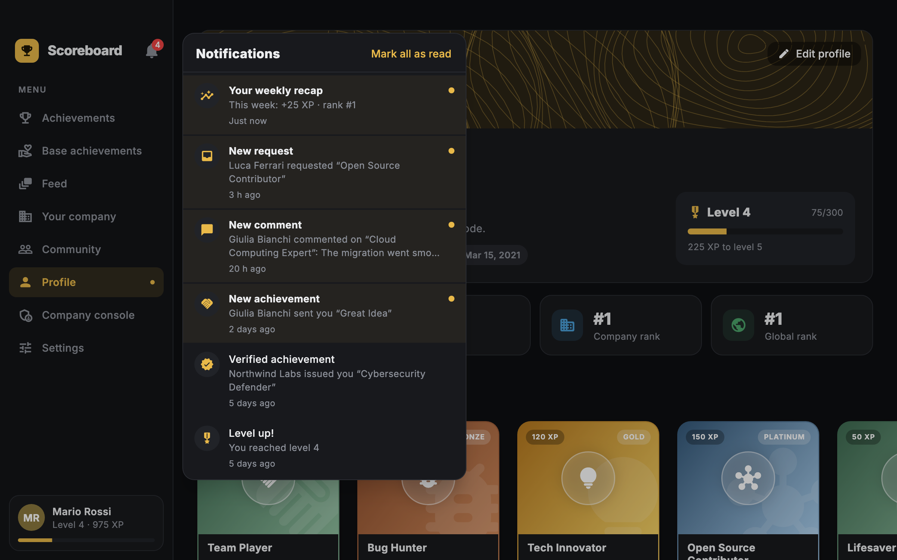
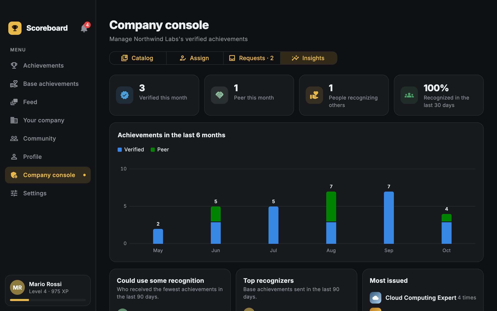
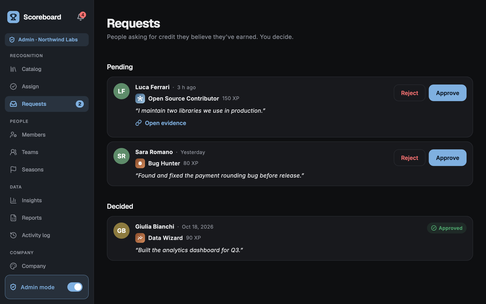
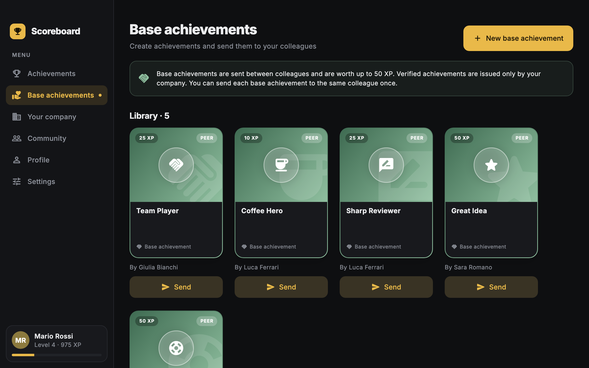
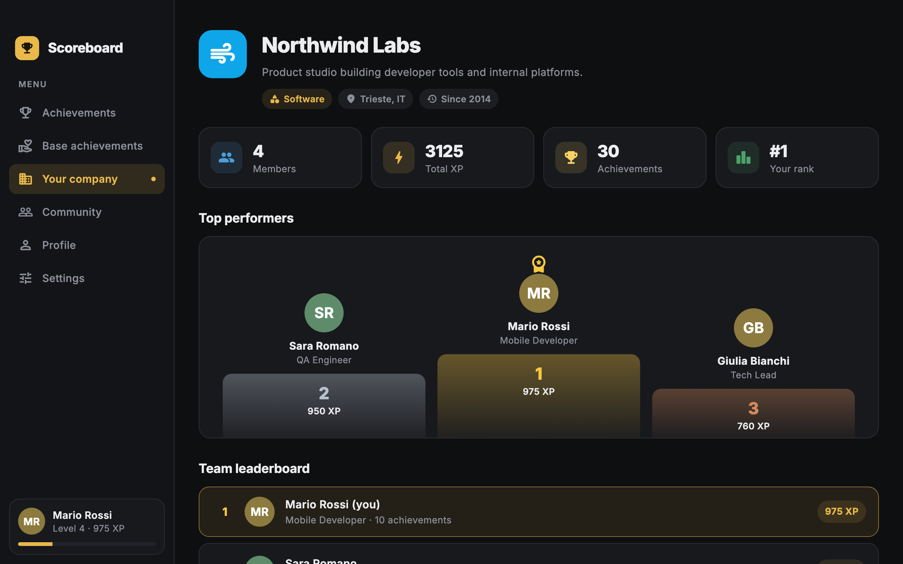
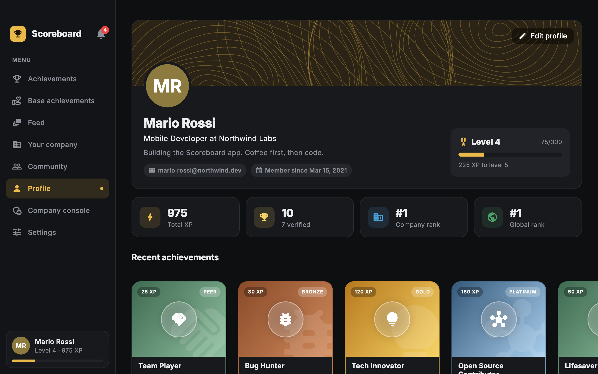

# Scoreboard

A desktop app for workplace recognition, for macOS, Windows and Linux. Companies issue **verified achievements** to their people, and colleagues send each other lighter **base achievements**. Everything adds up to XP, levels and leaderboards. Achievements look like collectible cards: they tilt under the cursor and flip over to show who issued them.



## Features

- **Collectible cards.** Each achievement is a card with a 3D tilt, a light that follows the cursor and a back side.
  - Verified cards show the issuing company's logo, like a certificate.
  - Cards received from a colleague show the sender and their message.
- **Two kinds of achievements.**
  - *Verified*: issued only by the company. Worth up to 150 XP, ranked Bronze, Silver, Gold or Platinum.
  - *Base* (peer): created by anyone and sent between colleagues of the same company. Worth 10, 25 or 50 XP.
- **A shared library of base achievements.** Create your own with a name, description, icon and value, send them with an optional message, and see everything you sent.
- **Leaderboards.**
  - *Your company*: team ranking with a top-3 podium.
  - *Community*: everyone and every company, with search.
- **Profile.** Photo, cover (six patterns or your own image), bio, level progress and recent achievements.
- **Company console** (company admins only), behind an **admin mode** switch at the bottom of the sidebar: the sidebar then lists the console sections, grouped into recognition, people, data and company, and the whole window turns steel blue instead of gold, so managing the company never looks like using the app.
  - Manage the catalog of verified achievements: create, edit, archive.
  - Issue an achievement to one or more people at once.
  - Approve or reject the requests members send, and the proposals managers make, with evidence links and a reason.
  - **Teams**: create teams, give each a manager, move people between them.
  - **Seasons**: periods with their own leaderboard (they can't overlap); the one in progress shows in *Your company* with days left, your place and the top 3.
  - **Reports** for HR: CSV of the achievements or of each person's totals over a period (ready for Excel: UTF-8 with BOM, formulas neutralized), and everything held about one person as JSON for data protection requests.
  - **Activity log**: every admin action and every export, with who did it and when.
  - **Company look**: an accent color and a logo replacing Scoreboard's gold and trophy for everyone in the company. The color is adjusted per theme so text stays readable.
  - **Work anniversaries**: a verified achievement on each anniversary the company picks (1, 2, 3, 5, 10, 15, 20 years), issued automatically.
- **Team managers** get a *My team* page: how each member is being recognized, who has received nothing for a month, a shortcut to send them an achievement and a way to propose a verified one, which reaches the admins as a request.
- **Requests.** Members browse the company catalog in *Your company* and ask for an achievement, attaching a message and a link to evidence.
- **Company feed.** Every achievement a colleague receives becomes a post, with reactions (like, celebrate, love, insightful) and comments.
- **Notifications.**
  - A bell in the sidebar opens the notification center.
  - New notifications also show up as system notifications on macOS, Windows and Linux.
  - They cover achievements received, level ups, request outcomes, new requests for admins, reactions, comments and a weekly recap.
- **Credentials** for verified achievements: a PDF certificate and an [Open Badges 3.0](https://www.imsglobal.org/spec/ob/v3p0/) credential (JSON, unsigned until the backend can sign it with the issuer's key).
- **Share on LinkedIn.**
  - Open a post with ready-made text.
  - Add a verified achievement to your profile under *Licenses & certifications*.
  - Save a 1200×627 image of the card to attach to the post.
- **Fair recognition.** Everyone can send up to 5 base achievements a month, and anyone can hide from the global Community leaderboard while staying visible to their colleagues.
- **Company insights** in the console: monthly activity, a 6-month chart, who could use some recognition, top recognizers and the most issued achievements.
- **Desktop integration.**
  - A tray (menu bar) icon to open the app or send an achievement. On macOS and Windows closing the window keeps the app in the tray.
  - Keyboard shortcuts, listed in *Settings → About*.
  - An update check against the GitHub releases.
- **Getting started.** A short introduction on first sign-in, search and sorting for your achievements, and a helpful empty state.
- **Accounts.** Sign in, registration, email and password changes, sign out.
- **Light and dark themes**, with the choice remembered.

| | |
|---|---|
|  |  |
|  |  |
|  |  |
|  |  |
|  | |

## Getting started

Requirements: Flutter 3.47 or newer (Dart 3.3+), plus the toolchain for your platform. Each platform builds only on its own OS.

| Platform | Toolchain |
|---|---|
| macOS | Xcode and CocoaPods (`brew install cocoapods`) |
| Windows | Visual Studio 2022 with the *Desktop development with C++* workload |
| Linux | `clang cmake ninja-build pkg-config libgtk-3-dev libx11-dev libxi-dev` (e.g. `sudo apt install …` on Debian/Ubuntu) |

```sh
flutter pub get
flutter run -d macos     # or: -d windows, -d linux
```

The first launch opens the sign-in screen. Sign in with the demo account (the **Use it** button fills it in), or create a new account in one of the sample companies.

| Email | Password |
|---|---|
| `mario.rossi@northwind.dev` | `scoreboard` |

The demo user is the admin of Northwind Labs and the manager of its *Platform & QA* team, so both the company console (turn on *Admin mode* at the bottom of the sidebar) and the *My team* page are available. Seed data includes pending requests, feed activity and a few notifications.

> The `android`, `ios` and `web` folders are the default Flutter scaffolding. The app depends on [`multiview_desktop`](https://pub.dev/packages/multiview_desktop) for its native window and targets desktop only.

### Keyboard shortcuts

⌘ on macOS, Ctrl on Windows and Linux.

| Shortcut | Action |
|---|---|
| ⌘K | Send an achievement |
| ⌘⇧N | Open notifications |
| ⌘1 … ⌘8 | Go to a page, in sidebar order |
| ⌘, | Settings |

### Platform differences

- **macOS**: the title bar is hidden. The content extends under it, next to the traffic lights, and the top edge of the window is draggable.
- **Windows and Linux**: the native title bar is kept, with its minimize, maximize and close buttons.

Both behaviors are defined in [lib/core/window_chrome.dart](lib/core/window_chrome.dart).
- **Tray.** On macOS and Windows closing the window hides it in the tray (menu bar). Quit from the tray menu, or with ⌘Q on macOS. Linux keeps the regular close, because GNOME shows tray icons only with the AppIndicator extension.
- **Haptics.** On macOS, holding an achievement card flips it with an "alignment" tap on the Force Touch trackpad. The trackpad plays haptics only during a press that is still held: the instant of a click is taken by the click's own feedback, and after release nothing is felt, so plain clicks get none. Flutter doesn't bridge haptics on macOS, so [MainFlutterWindow.swift](macos/Runner/MainFlutterWindow.swift) answers the `scoreboard/haptics` channel used by [lib/core/haptics.dart](lib/core/haptics.dart). It can be turned off in *Settings → Appearance*; Windows and Linux have no equivalent API, and the setting is hidden there.

## Data and persistence

There is no backend yet. All data goes through the `ScoreboardRepository` interface ([lib/services/scoreboard_repository.dart](lib/services/scoreboard_repository.dart)), and the app currently uses `MockScoreboardRepository`, a local stand-in:

- **Seed data**: 4 companies, each with an admin and a catalog, 12 people and their achievements, plus requests, feed activity and notifications. Achievements are rebuilt at every launch. The other collections are seeded once and then saved.
- **Saved data**: everything created in the app is stored with `shared_preferences` and survives restarts. That covers accounts, profile edits, base achievements, sent and issued achievements, catalog changes, requests, reactions, comments and notifications.
- **Notifications** are created by the repository, as a server would do. A backend can push them instead.
- **Images**: profile photos and covers are copied into the app's support directory, so moving or deleting the original file doesn't break them.
- **Passwords**: stored as salted SHA-256 hashes, never in plain text. This is fine for a local mock. A real backend should hash passwords server-side with a slow algorithm such as bcrypt or Argon2.

To connect a real backend, implement `ScoreboardRepository` (the HTTP client in [lib/api](lib/api) is a starting point) and register it in [lib/core/locator/locator_objects.dart](lib/core/locator/locator_objects.dart). Business rules, such as who can send what, the XP limits and the one-per-colleague rule, live in the interactors, so they don't change. They should also be enforced by the server.


Teams, seasons, the activity log, company settings and work anniversaries live in the mock backend for now, behind the same `ScoreboardRepository` contract a real backend will implement. The rules sit in the interactors (`TeamInteractor`, `SeasonInteractor`, `ReportInteractor`, `CompanySettingsInteractor`, `ActivityInteractor`). With a backend, the activity log and the anniversaries should move server side, where an action can't skip its log entry and anniversaries are issued by a scheduled job.
## Architecture

The app follows an MVVM-style structure wired with [`get_it`](https://pub.dev/packages/get_it):

```
View (State) ──calls──▶ ViewModel ──calls──▶ Interactor ──calls──▶ Repository / Services
     ▲                      │
     └──── contract ────────┘   (the ViewModel asks the View to navigate, show dialogs, …)
```

- **Views** implement a *view contract*. They render the state and forward user actions.
- **ViewModels** hold the screen state, a `ChangeNotifier` exposed through `provider`, and call interactors.
- **Interactors** contain the business rules:
  - `ScoreboardInteractor`: achievements, leaderboards, profile.
  - `AuthInteractor`: accounts and passwords.
  - `AppConfigurationInteractor`: theme and app info.
- **Services** wrap the data source and the platform: repository, preferences, file picker, image storage, package info.

```
lib/
├── app/           MaterialApp, routes, themes
├── core/          theme, locator (get_it), routing, formatters
├── interactors/   business rules
├── model/         plain data classes
├── services/      repository interface, mock repository, platform services
├── views/         one folder per screen: contract, view model, view
│   ├── _base/     base classes shared by every screen
│   └── _shared/   flows reused by several screens (sending an achievement)
└── widgets/       reusable widgets: cards, dialogs, sidebar, leaderboard rows
```

## Development

```sh
flutter analyze        # lints (flutter_lints)
flutter test           # unit and widget tests
dart format lib test   # formatting
flutter build macos    # release build (also: windows, linux)
```

Notes:

- Tests live in `test/unit` (models and interactors, run against the mock backend) and `test/widget` (screens and components). `test/helpers/test_app.dart` builds the app as `main` does, on in-memory preferences, with the mock backend's latency turned off and fakes for system notifications and the GitHub update check. Tests compare against the localized strings rather than hard-coded text, and seed data is relative to today, so they assert on rules rather than on fixed values.
- The UI uses the **Inter** typeface, bundled in `assets/fonts` under the SIL Open Font License (`OFL.txt`, also shown in the app's licenses). The certificate PDFs embed it too.
- Picking and saving images on macOS needs `com.apple.security.files.user-selected.read-write`, which is also enabled.
- The native window is managed by [`multiview_desktop`](https://pub.dev/packages/multiview_desktop): one Flutter engine for every OS window, so a second window (a detail, a settings panel) can be opened later without a new engine. It needs its own runner code, already in place: [MainFlutterWindow.swift](macos/Runner/MainFlutterWindow.swift) and [AppDelegate.swift](macos/Runner/AppDelegate.swift) on macOS, [windows/runner](windows/runner) and [linux/runner](linux/runner) from the package's example.
- Every macOS plugin now ships as a Swift package, but the project still builds with CocoaPods; Flutter suggests migrating and prints a notice until then.

## Releasing

[.github/workflows/release.yml](.github/workflows/release.yml) runs when a `v*` tag is pushed:

1. Set `version:` in `pubspec.yaml` (for example `0.2.0+1`).
2. Commit, then tag and push it: `git tag v0.2.0 && git push origin v0.2.0`.
3. The workflow checks that the tag matches the version and runs the CI checks, then builds:
   - a DMG for macOS;
   - a zip for Windows;
   - a tarball for Linux.
4. It publishes them on a GitHub Release. The app's update check finds that release and offers the download.

Signing is optional and turns on when the repository has these secrets:

- **macOS**: `MACOS_CERTIFICATE` (base64 Developer ID `.p12`), `MACOS_CERTIFICATE_PASSWORD` and `MACOS_SIGNING_IDENTITY`.
- **macOS notarization**: also `APPLE_ID`, `APPLE_TEAM_ID` and `APPLE_APP_PASSWORD`.
- **Windows**: `WINDOWS_CERTIFICATE` (base64 `.pfx`) and `WINDOWS_CERTIFICATE_PASSWORD`.

Without them the packages are built unsigned.

## Localization

The whole UI is translated into **English**, **Italian** (the main locale), **Spanish**, **French** and **German**, using [`intl_utils`](https://pub.dev/packages/intl_utils) (the `flutter_intl` setup in `pubspec.yaml`).

- The app follows the system language, and falls back to English when the system language isn't supported. Users can override it in *Settings → Appearance*.
- Strings live in `lib/l10n/intl_<language>.arb`. Parameters and plurals are described in the Italian file.
- Tests check that every language has the same messages and placeholders as English, and that every page fits the smallest window in each language.
- Widgets read them with `context.l10n.someKey`, which rebuilds them when the language changes. View models use the global `l10n`.
- The domain layer reports errors as codes (`AuthError`, `SendAchievementError`), and [lib/core/l10n_messages.dart](lib/core/l10n_messages.dart) turns them into text.
- Dates are formatted for the current locale.
- Seed data (achievement names, companies) is content, not UI, so it isn't translated.

To add or change a string, edit every ARB file and regenerate `lib/generated`:

```sh
dart run intl_utils:generate && dart format lib/generated
```

To add a language, add its `intl_<code>.arb` with every key of `intl_en.arb`, and list it in the language menu (`_languages` in [settings_view.dart](lib/views/settings/settings_view.dart)).

The Flutter Intl IDE plugin does the same thing on save.

## Accessibility

- **Keyboard**: every control can be reached with Tab and used with Enter or Space, with a visible focus ring. Achievement cards open with Enter and flip with F. The shortcuts are listed in *Settings → About*.
- **Screen readers** (VoiceOver, Narrator, Orca): cards are read as one button ("Cloud Computing Expert. Platinum, 140 XP. Verified. Northwind Labs. …") with flipping as an extra action; the current page is announced as selected; the bell says how many notifications are unread.
- **Contrast**: text meets WCAG AA (4.5:1) in both themes. Colored labels (tiers, statuses, reactions) are darkened or lightened by `AppColors.legible` until they do, so they keep their hue.
- **Reduced motion**: with the system setting on, cards don't tilt and flip instantly.
- [test/widget/accessibility_test.dart](test/widget/accessibility_test.dart) runs Flutter's accessibility guidelines (labels, 24×24 targets, contrast) on every page in both themes, plus the keyboard and screen-reader checks above.

## License

Released under the [Apache License 2.0](LICENSE).
